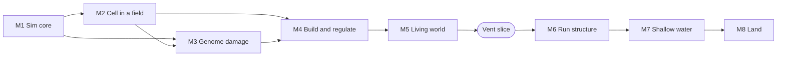

# Gameplay core: design and roadmap

Status: agreed in a design review on 2026-10-15, branch `core-gameplay-design`.
This document records the decisions and the order of work. Items marked
**playtest** need numbers from play before we fix them.

## 1. The game in one paragraph

You are one cell, a blob, in a 2D sprite world. Each level is an
evolutionary stage: deep-sea vents, then shallow water, then land. You move
through a field of resources and hazards that you can see: heat, minerals,
light, oxygen, water. Your metabolism turns what you absorb into energy and
into proteins. Enzymes make your pathways faster. Membrane proteins give you
actions: move, absorb, attack, pass through walls. To finish a level, you
must engulf its gate cell and take its gene. That gene is the innovation that
lets you survive the next stage. You die when ATP or membrane integrity
reaches zero.

## 2. Decisions

### Run and death

- Death: ATP = 0, or membrane integrity = 0.
- Advance: you must have the stage's key innovation. A missing innovation is
  also a hazard. Example: early light zones are deadly because nothing
  protects your genome from UV.
- Each level ends with a gate cell. When you engulf it, you take its gene and
  win the level.

### Proteins and enzymes

- Amino acids + ATP make protein units. You allocate them:
  - to a pathway, as **enzymes**: they make the pathway faster;
  - to the membrane, as **transmembrane proteins**: transporters, flagella,
    adhesins, toxins, receptors.
- Proteins do not decay. You can recycle a protein for about half of its
  amino acids.
- Limits:
  - Membrane proteins need surface area. A bigger cell has more area, but it
    is slower and costs more ATP to maintain.
  - Pathways compete for the same primary inputs, so you cannot run many at
    full rate. Stacking enzymes in one pathway is a valid min-max. Each stage
    still needs some variety to survive its resources and hazards.
- Actions cost ATP and/or a cofactor for each use.

### Cofactors

- Start with one: **Metals** (Fe-S clusters), from the vents.
- Each later stage adds one at most. Fewer than four in total.

### Mutation and UV

- UV lowers membrane integrity at once (lipid peroxidation), and it causes
  gene mutations at a rate.
- A mutated gene gives a weaker block. Repair costs ATP + Nucleotides.
- Moderate UV lowers transcription/translation efficiency: protein synthesis
  is slower.
- Extreme UV fragments the genome: you cannot make new proteins.
- Pigments (`SecondaryMetabolites`) screen UV.
- Optional high-risk strategy: induce mutation on purpose for a chance of a
  beneficial effect.

### New genes

- Main source: horizontal gene transfer. You engulf or merge with a cell and
  take one of its genes.
- Gate cell at the end of each level: a guaranteed, stage-specific gene.
- Viruses: a risky gene transfer. You get a gene or a mutation.
- Beneficial mutation: rare, and only from induced mutation.

### Editing and live control

- You can open the editor at any time. Game time keeps running, unless you
  are in a **shelter**.
- Shelters: a vent crevice, a microbial mat, a moist soil pore. Each level
  has only a few. Inside a shelter, hazard fields are calm and hostile cells
  do not enter. A shelter is not a save point. **Playtest:** whether to slow
  time outside shelters, and if a shelter has limited resources.
- Structure (genes, enzyme and membrane allocation) is slow, like protein
  synthesis. The editor makes a synthesis queue, and your metabolism builds it
  in game time.
- Regulation is fast, like gene expression. About **4 action slots**. A slot
  holds a pathway (Off / Low / High) or a membrane protein action (flagellum
  burst, toxin, adhesin). Each change has a short ramp time and a small ATP
  cost. Passive effects of pathways always apply; only actions use slots.

### Pathway competition (solver change)

- Pathway rate = enzymes x S / (K + S), where S is the input substrate. This
  is a simplified Michaelis-Menten rate. Enzymes scale the rate linearly. The
  substrate supply sets the ceiling.
- When the total demand for a pool is more than the pool holds, each consumer
  gets a share in proportion to its demand.
- This replaces the current greedy order in `solve_tick`, where the first
  block in `BlockKind` order takes all of a shared input. Stoichiometry stays
  conserved, pools never go negative, and the result must not depend on the
  tick length.

### Spatial environment

- A coarse grid field per external channel: Heat, Minerals, Light/UV,
  OrganicCarbon, O2, Water (land only). Each channel has cheap diffusion,
  sources and decay.
- A cell samples the grid at its position. Transporters set how fast
  substances move between the grid and the cell's pools.
- Visual styling shows each channel (colour, glow, particles), so the player
  sees where to go and where to flee.
- This replaces the global `EnvironmentalCurrencyPools` resource.

### Internal pools (currency set)

| Group | Pools |
|---|---|
| Energy | ATP, ReducingPower |
| Carbon hub | Pyruvate, CarbonSkeletons (absorbs AcetylCoA) |
| Building | AminoAcids (proteins), Nucleotides (genome repair), Lipids (membrane repair and growth; absorbs FreeFattyAcids and StorageBeads as a stored form) |
| Cofactor | Metals |
| Waste | Waste |

Membrane integrity costs Lipids to repair. This connects defence to
metabolism.

### World membranes and tissue

- A membrane wall blocks movement and also blocks diffusion in the grid.
- Three ways to deal with a wall:
  - a matching **transporter** pulls substrate through it (feed without
    passing);
  - a **fusion/adhesin** protein lets you pass through slowly;
  - a **lytic** enzyme damages it. It costs a cofactor, and some walls fight
    back.
- Tissue is cells joined by walls. The number and range of tissue types
  increase with each stage.

### Other entities

- Prey, predators, symbionts and gate cells use the same `Cell` model as the
  player, with a real `Genome`. When you engulf one, you can take its genes.
- They run a slower metabolic tick than the player. Their behaviour comes
  from a small rule set for each archetype.
- Food particles and viruses are light entities with no metabolism.
- **Playtest:** the CPU cost of NPC metabolism. Simplify NPC behaviour or
  metabolism if necessary.

### Movement

- avian2d. Circle colliders with linear drag.
- Thrust comes from flagella or cilia. Size sets mass and drag, so a bigger
  cell is slower.
- The blob look is visual only: the sprite squashes and wobbles from velocity
  and contacts. There is no soft-body physics.
- Land uses the same controls and model, with a different drag value.

### Meta progression

- A codex: each gene that you obtained once can be a starting gene later.
- At the start of a run, you choose a small starting genome from the codex,
  with a budget.
- No stat upgrades that carry over between runs.

### Stages

| Stage | Primary energy | Main hazard | Key innovation | Gate cell gives |
|---|---|---|---|---|
| Vents | Chemosynthesis: Minerals + Heat -> ATP, carbon | Heat at the vent core; scarcity away from it; deadly light zones | Pigments (UV screen) | LightCapture (a pigmented phototroph) |
| Shallow water | Photosynthesis: Light -> ATP, ReducingPower | UV; **your own O2 and reactive oxygen species** | O2 detox (catalase), then respiration | Respiration (an alpha-proteobacterium, as a mitochondrion) |
| Land | Respiration: O2 + carbon -> much more ATP | Desiccation (Water field) | Cuticle / thick membrane | Open (multicellularity?) |

The shallow-water stage is the Great Oxidation Event. Your new, more powerful
metabolism is the source of the risk: the pathways you build produce reactive
oxygen species that damage you. The tone is a little body horror. On land,
you must stay near water, the world you left behind.

## 3. Current code compared with the design

| Area | Now | Change |
|---|---|---|
| Solver | Greedy, in `BlockKind` order; rate is fixed per gene state | Enzymes, saturation, proportional sharing |
| Pools | 8 abstract currencies | The 9 pools above |
| Blocks | Fermentation, FatStorage, VesicleExport | Chemosynthesis, pigments, photosynthesis, catalase, respiration, protein synthesis, repair |
| Genome | `Silent` / `Expressed` / `Mutated`; random mutation in `MetabolicSet::Genome` | Mutation driven by UV and ROS, repair, translation efficiency, gene transfer |
| Environment | Global `EnvironmentalCurrencyPools` | Spatial grid with channels |
| Run screen | `RunPlayer` disc with WASD; not linked to a `Cell` | The player is a `Cell` with a body; movement costs ATP |
| Physics | None | avian2d |
| Manage screen | Placeholder | Editor, synthesis queue, action slots |
| Run structure | Screens only | Levels, death, victory, codex |

Out of date: the multiplayer and mitochondrial-genome items in `TODO.md`, and
`flowmap_design.md`. Mitochondria now come from endosymbiosis (the shallow
water gate cell), not from a second genome system.

## 4. Roadmap

Each milestone ends with something that runs and that we can test. Milestones
1 and 3 are headless work (`cargo th`). The others need the smoke test.

### M1. Simulation core (headless)

1. Change the pool set to the 9 pools. Move Fermentation, FatStorage and
   VesicleExport to it.
2. Change `solve_tick`: enzyme count per block, saturation, and proportional
   sharing of shared inputs. Proptests: mass conserved, no negative pools,
   tick-length independence, more enzymes never lowers a block's rate.
3. Protein economy: a protein synthesis block (AminoAcids + ATP -> protein
   units), an enzyme allocation for each block, membrane slots from cell size,
   a synthesis queue, recycling.
4. Chemosynthesis block (Minerals + Heat -> ATP, carbon), with Metals as a
   cofactor.
5. Membrane integrity on the cell; repair costs Lipids.

Done when: a headless test cell lives on a constant mineral supply, builds
enzymes from a queue, and two pathways share an input in proportion to their
enzymes.

### M2. A cell in a field (first playable)

1. `EnvGrid` resource: channels, diffusion, sources, decay as pure functions.
   Replace `EnvironmentalCurrencyPools`. Transporters exchange with the grid
   cell under the body.
2. The Run player is the local player's `Cell`, with a body. Replace the
   separate `RunPlayer` disc.
3. avian2d: circle collider, drag, thrust from flagella, size -> mass and
   drag. Movement costs ATP.
4. Sprite rendering of the grid channels (heat glow, mineral plumes, light).
   The blob wobbles with velocity.
5. Death on ATP = 0 or membrane = 0, and a run-over screen.
6. HUD: ATP, membrane, main pools.

Done when: you can play a vent field, find minerals, and starve or burn.

### M3. Genome damage

1. A Light/UV channel. UV damages the membrane and causes mutations.
2. Replace random mutation with mutation from fields.
3. Repair (ATP + Nucleotides). Translation efficiency lowers synthesis rate.
   Extreme damage fragments the genome.
4. Pigment block screens UV.
5. Induced mutation as an action (risky).

Done when: light zones kill a cell without pigment, and a cell with pigment
survives.

### M4. Build and regulate

1. Manage screen: genome, enzyme allocation, membrane slots, synthesis queue.
2. Shelters: calm zones where game time stops while the editor is open.
3. Action bar with 4 slots: pathway Off / Low / High, and membrane protein
   actions, with ramp time and ATP cost.
4. Hotkeys for the slots.

Done when: you can plan a build in a shelter, see it get built in game time,
and switch pathways during play. **Playtest** the time rules here.

### M5. Living world (vent slice)

1. NPC cells with the `Cell` model at a slower tick, and simple archetype
   behaviour: prey, predator, symbiont. Measure the CPU cost.
2. Engulf: contact + size check. Gene transfer from engulfed cells.
3. Food particles and viruses.
4. Membrane walls in the world: block movement and diffusion. Transporter,
   fusion/adhesin and lytic interactions.
5. Vent level layout: vent core, mineral plumes, light zones, shelters,
   tissue, the gate cell.
6. Gate cell: engulf it to win the level.

Done when: a full vent run can be won or lost. This is the **vertical
slice**. Tune it before we build more stages.

### M6. Run structure

1. Run state: the stage sequence, level transitions, win and loss.
2. Codex: save obtained genes. Choose a starting genome with a budget.
3. Some level variation (procedural layout of fixed parts).

### M7. Shallow water

1. Photosynthesis block. It produces O2 into the cell and the grid.
2. Reactive oxygen species: damage from your own O2. Catalase block.
3. Respiration gate cell (endosymbiosis).
4. More tissue types.

### M8. Land

1. Respiration block (O2 + carbon -> much more ATP).
2. Water channel and desiccation. Cuticle / thick membrane.
3. Land drag value. Tissue at its most complex.

## 5. Open questions

- Time rules for the editor outside shelters (stop, slow, or full speed).
- Shelter resources: unlimited or limited.
- NPC metabolism cost, and how much to simplify it.
- The second and third cofactors.
- What the land gate cell gives (multicellularity?), and if there is a
  fourth stage.
- Grid resolution compared with cell size.
